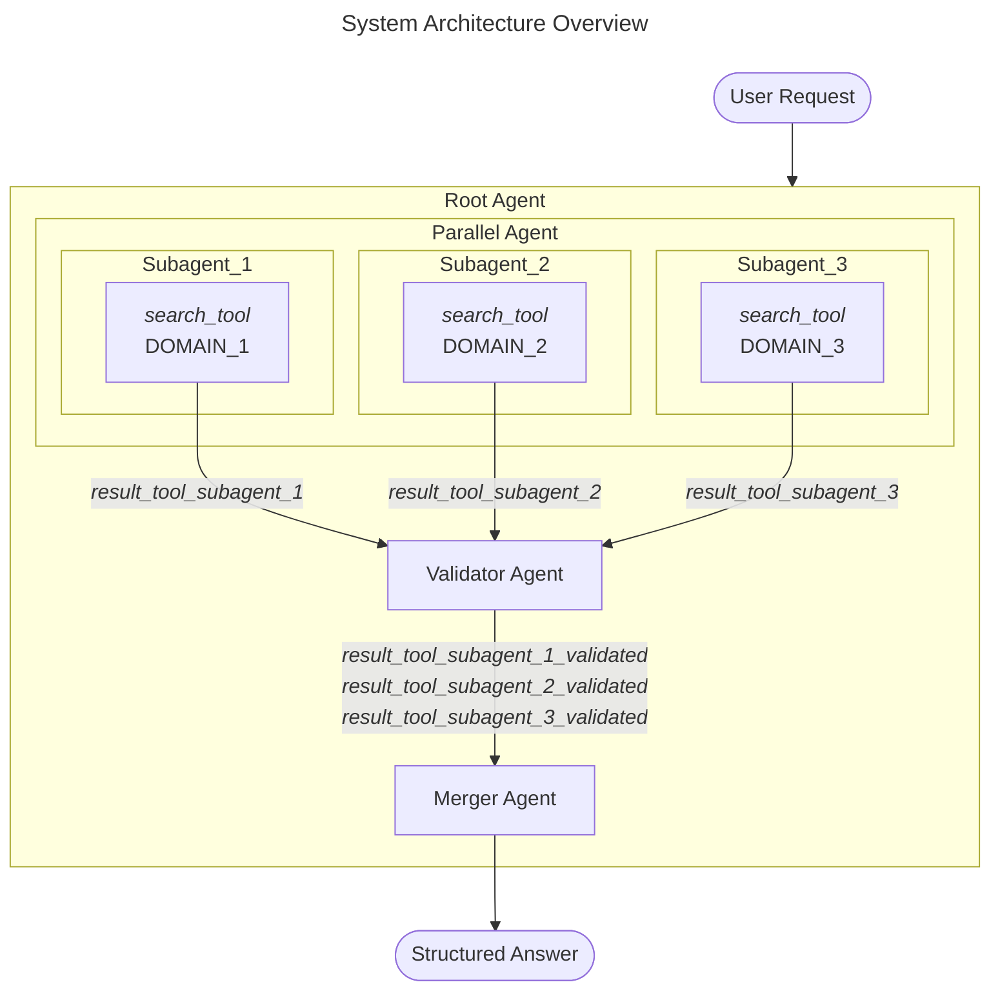
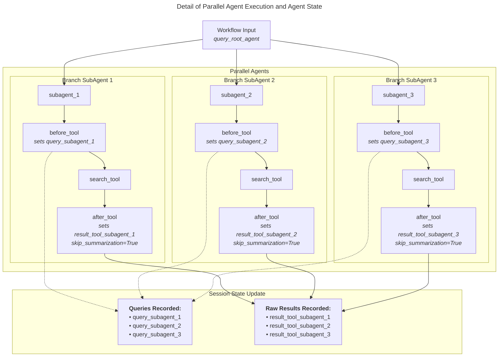
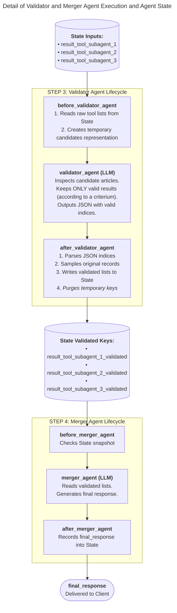

# Research Merge Orchestrator

An enterprise-grade, multi-agent AI research and synthesis platform built with the **Google Agent Development Kit (ADK)**, **FastAPI**, and **Langfuse**. The system coordinates parallel, domain-specialized sub-agents to query high-signal technical sources, performs automated multi-stage candidate validation (domain verification, temporal recency, and semantic relevance), and synthesizes validated intelligence into a peer-reviewed, strictly grounded scientific report with deduplicated citations.

---

## Table of Contents

- [Project Description](#project-description)
- [Architecture Description](#architecture-description)
  - [System Architecture Overview](#system-architecture-overview)
  - [Agent State Dynamic Evolution](#agent-state-dynamic-evolution)
  - [Detail of Parallel Agent Execution and Agent State](#detail-of-parallel-agent-execution-and-agent-state)
  - [Detail of Validator and Merger Agent Execution and Agent State](#detail-of-validator-and-merger-agent-execution-and-agent-state)
- [Technologies Description](#technologies-description)
- [Features](#features)
- [Installation](#installation)
  - [System Requirements](#system-requirements)
  - [Local Installation](#local-installation)
  - [Docker & Docker Compose Installation](#docker--docker-compose-installation)
- [Usage](#usage)
  - [Running Locally](#running-locally)
  - [Running with Docker Compose](#running-with-docker-compose)
  - [Configuration Options & Environment Variables](#configuration-options--environment-variables)
  - [Execution Examples & Sample Outputs](#execution-examples--sample-outputs)
- [API Documentation](#api-documentation)
  - [GET `/api/status`](#get-apistatus)
  - [POST `/api/research`](#post-apiresearch)
  - [POST `/api/research/debug`](#post-apiresearchdebug)

---

## Project Description

Conducting deep technical research using Large Language Models often leads to significant operational challenges:
- **Search Engine Limitations & Bot Blocking**: Unofficial scraping libraries and rate-limited search APIs frequently encounter HTTP `429 Too Many Requests` or `202 Accepted` bot-detection challenges.
- **Context Pollution & Stale Data**: Generic search queries retrieve outdated articles, tag hubs, and landing pages that contaminate the LLM context window with irrelevant information.
- **Reasoning Model Overthinking Loops**: Reasoning models consume tens of thousands of output tokens in open-ended Chain-of-Thought (CoT) loops, resulting in latency spikes and premature truncation before the final response is generated.
- **Hallucinated & Duplicate Citations**: Aggregating unvalidated raw articles leads to fabricated publication dates, broken links, and duplicate entries in compiled bibliographies.

### Purpose and Motivation
**Research Merge Orchestrator** solves these issues by establishing a disciplined, multi-stage agentic pipeline. It decouples broad discovery from deep evaluation by deploying concurrent sub-agents to targeted domains (`deeplearning.ai/the-batch`, `techcrunch.com`, `arstechnica.com/ai`), validating candidates through a lightweight short-circuit filter (domain matching, strict 4-month recency cutoff, and semantic relevance), and passing verified records into an isolated synthesis engine.

By enforcing native minimal thinking configurations (`thinking_level="minimal"`, `include_thoughts=False`) and isolating the final synthesizer from noisy chat history (`include_contents="none"`), the platform delivers verifiable, fully cited research briefs within seconds while guaranteeing source transparency.

---

## Architecture Description

The architecture is implemented as a hierarchical state machine orchestrated by Google ADK's `SequentialAgent` and `ParallelAgent` abstractions.

### System Architecture Overview



#### Detailed Description: System Architecture Overview
The overall workflow represents a strictly gated, four-stage hierarchical pipeline encapsulated inside the **Root Agent** (`root_agent`, a Google ADK `SequentialAgent`):
1. **User Request Ingestion**: The client request enters the API and is dispatched to `root_agent`. A pre-execution callback captures the natural language query into the shared session state.
2. **Parallel Domain Research**: The `Parallel Agent` (`ParallelWebResearchAgent`) simultaneously activates three specialized research agents (`subagent_1`, `subagent_2`, and `subagent_3`). Each sub-agent queries its designated authoritative domain (`DOMAIN_1`, `DOMAIN_2`, and `DOMAIN_3`) using the underlying search tool and produces raw candidate payloads (`result_tool_subagent_1`, `result_tool_subagent_2`, and `result_tool_subagent_3`).
3. **Candidate Validation Gatekeeper**: The execution transitions to the **Validator Agent** (`validator_agent`). Acting as a quality gate, it evaluates candidate metadata without inspecting article content, discarding outdated, out-of-domain, or irrelevant items to produce verified result sets (`result_tool_subagent_*_validated`).
4. **Synthesis & Formatting**: The **Merger Agent** (`merger_agent`) receives exclusively the validated records. It synthesizes the information into a cohesive, scientific narrative and formats a deduplicated bibliography.
5. **Structured Answer**: The client receives a clean, cited report adhering to strict line-count and formatting constraints.

---

### Agent State Dynamic Evolution

```mermaid
---
title: Agent State Dynamic Evolution
---
flowchart TD
    %% STEP 1
    subgraph S1 ["STEP 1: Ingestion & Root Query"]
        direction TB
        USER(["User Request"]) --> INIT["initial_session_created<br/><i>run_orchestrated_research</i>"]
        INIT --> CB_ROOT["before_root_agent callback"]
        STATE_1[("<b>State Snapshot 1</b><br/>• query_user<br/>• query_root_agent")]
        CB_ROOT -.->|Populates| STATE_1
    end

    %% STEP 2
    subgraph S2 ["STEP 2: Parallel Research"]
        direction TB
        PARALLEL["ParallelWebResearchAgent<br/><i>subagent_1, subagent_2, subagent_3</i>"]
        STATE_2[("<b>State Snapshot 2</b><br/><i>(All previous keys plus:)</i><br/>• query_subagent_1<br/>• query_subagent_2<br/>• query_subagent_3<br/>• result_tool_subagent_1<br/>• result_tool_subagent_2<br/>• result_tool_subagent_3")]
        PARALLEL -.->|Populates| STATE_2
    end

    %% STEP 3
    subgraph S3 ["STEP 3: Date & Quality Validation"]
        direction TB
        VALIDATOR["validator_agent<br/><i>Discards invalid results</i>"]
        STATE_3[("<b>State Snapshot 3</b><br/><i>(ONLY queries plus:)</i><br/>• result_tool_subagent_1_validated<br/>• result_tool_subagent_2_validated<br/>• result_tool_subagent_3_validated")]
        VALIDATOR -.->|Populates| STATE_3
    end

    %% STEP 4
    subgraph S4 ["STEP 4: Synthesis & Output Delivery"]
        direction TB
        MERGER["merger_agent<br/><i>Synthesizes validated results list</i>"]
        STATE_4[("<b>Final State Snapshot</b><br/>• All queries (user, root, subagents)<br/>• Raw tool results (1, 2, 3)<br/>• Validated tool results (1, 2, 3)<br/>• <b>final_response</b>")]
        FINAL(["final_workflow_completed<br/><i>Client HTTP Response</i>"])
        MERGER -.->|Populates| STATE_4
        STATE_4 --> FINAL
    end

    %% Pipeline flow between steps
    S1 ==> S2
    S2 ==> S3
    S3 ==> S4
```



#### Detailed Description: Agent State Dynamic Evolution
State management in the orchestrator is monotonic and cumulative, managed by Google ADK's `InMemorySessionService`. The state transitions through four distinct milestones:
- **STEP 1 (Ingestion & Root Query)**: When the user initiates a session, `query_user` is stored. The `before_root_agent` callback fires, extracting the initial text payload into `query_root_agent`. **State Snapshot 1** contains the foundational user queries.
- **STEP 2 (Parallel Research)**: During concurrent sub-agent execution, each sub-agent's pre-tool callback records its specific keyword query (`query_subagent_1`, `query_subagent_2`, `query_subagent_3`), while post-tool callbacks capture raw search payloads (`result_tool_subagent_1`, `result_tool_subagent_2`, `result_tool_subagent_3`). By **State Snapshot 2**, all candidate articles are collected.
- **STEP 3 (Date & Quality Validation)**: The validator agent evaluates candidates and creates three clean, filtered collections: `result_tool_subagent_1_validated`, `result_tool_subagent_2_validated`, and `result_tool_subagent_3_validated`. Any temporary candidate representations created for evaluation are purged from memory, leaving **State Snapshot 3** populated with verified records.
- **STEP 4 (Synthesis & Output Delivery)**: The merger agent consumes the validated collections, producing the final structured report stored in `final_response`. **State Snapshot 4** represents the complete telemetry state returned to the debug endpoint and logged in telemetry.

---

### Detail of Parallel Agent Execution and Agent State



#### Detailed Description: Detail of Parallel Agent Execution and Agent State
This diagram illustrates the concurrent execution path within the `ParallelWebResearchAgent`:
- **Branching Architecture**: Upon receiving `query_root_agent`, the orchestrator forks execution across `subagent_1`, `subagent_2`, and `subagent_3` in parallel async tasks.
- **Pre-Tool Interception (`before_tool`)**: Prior to calling `search_tool`, the `before_tool` callback dynamically intercepts the call, assigns the dedicated target domain (`DOMAIN_1`, `DOMAIN_2`, or `DOMAIN_3`), and writes the sub-agent's query into `query_subagent_X` in the session state.
- **Tool Invocation & Web Extraction (`search_tool`)**: The search tool queries the DuckDuckGo HTML backend protected by a micro-staggering thread lock (`0.15s - 0.30s`) to prevent burst collisions. URLs are scraped concurrently using `curl-cffi` with Chrome 120 TLS fingerprinting. Publication dates are normalized to `YYYY-MM-DD`.
- **Post-Tool Interception (`after_tool`)**: When the tool returns, `after_tool` stores the raw article list into `result_tool_subagent_X`. Crucially, it sets `tool_context.actions.skip_summarization = True`, instructing the sub-agent to terminate its turn without generating superfluous conversational summaries, minimizing latency and token consumption.

---

### Detail of Validator and Merger Agent Execution and Agent State



#### Detailed Description: Detail of Validator and Merger Agent Execution and Agent State
This diagram highlights the quality-control validation and subsequent final synthesis pipeline:
- **Lightweight Metadata Projection (`before_validator_agent`)**: Before `validator_agent` runs, this callback computes the UTC reference date and a strict 4-month cutoff date. It projects the raw candidate lists into lightweight text blocks (`candidate_records_agent_1`, `2`, `3`) containing only `index`, `title`, `link`, and `pub_date`. The heavy `content` key is excluded, reducing input tokens by ~98%.
- **Short-Circuit Validation Logic (`validator_agent`)**: The agent processes each candidate against three sequential checks:
  1. *Domain Legitimacy*: The link must belong to the designated domain. If not, the candidate is discarded immediately.
  2. *Publication Recency*: The date must fall within the 4-month threshold. Unknown or older dates are discarded immediately.
  3. *Relevance & Noise Removal*: Compares the title and link against `query_root_agent`, filtering out category feeds and off-topic pages.
  The agent returns a structured JSON block containing the surviving 0-based indices.
- **Sampling & Ephemeral State Purge (`after_validator_agent`)**: The callback cleans any Markdown code blocks, validates the indices, retrieves the original article dictionaries (with full `content` intact), and populates `result_tool_subagent_*_validated`. It then purges the temporary candidate strings from state memory.
- **History-Isolated Synthesis (`merger_agent`)**: Configured with `include_contents="none"`, the merger agent ignores prior event history, preventing unvalidated raw articles from leaking into the context window. It receives only `{result_tool_subagent_*_validated}` via system instruction template injection, compiling a 20–30 line narrative and a deduplicated bibliography.
- **Delivery**: The output is formatted via `clean_report_output` and returned as `final_response`.

---

## Technologies Description

| Technology | Version | Purpose in Solution |
| :--- | :--- | :--- |
| **Python** | `3.11` | Core runtime environment, selected for stability, container compatibility, and async support. |
| **Google ADK (`google-adk`)** | `2.5.0` | Orchestration framework managing `SequentialAgent`, `ParallelAgent`, `Runner`, and state lifecycle. |
| **Google GenAI (`google-genai`)** | `2.11.0` | Official SDK providing schema definitions and execution configurations (`GenerateContentConfig`, `ThinkingConfig`). |
| **FastAPI** | `0.139.0` | Asynchronous REST API framework routing client requests, serving static UI assets, and handling CORS. |
| **Uvicorn** | `0.40.0` | Production ASGI web server running the FastAPI application. |
| **DuckDuckGo Search (`ddgs`)** | `9.15.0` | Search library configured with `backend="html"` to query public search endpoints without triggering API rate limits. |
| **curl-cffi** | `0.16.0` | HTTP client with browser TLS impersonation (`chrome120`) to bypass anti-bot and Cloudflare protections during article scraping. |
| **BeautifulSoup4** | `4.15.0` | HTML parsing library extracting clean paragraph text, metadata tags, and publication timestamps. |
| **Langfuse** | `4.14.0` | Observability platform providing telemetry for workflow spans, tool executions, and LLM generations. |
| **Pydantic** | `2.13.4` | Data validation, request payload enforcement, and structured validation index schemas. |
| **Docker & Docker Compose** | Latest | Container runtime with non-root security (`appuser`), volume bind mounts, and automated health checks. |

---

## Features

- **Concurrent Multi-Agent Research**: Coordinates parallel sub-agents across isolated search domains, eliminating duplicate queries while maximizing technical breadth.
- **Anti-Bot & Rate-Limit Resilient**:
  - DuckDuckGo searches run via `backend="html"` guarded by an async thread lock.
  - Multi-threaded article fetching (`ThreadPoolExecutor`) with browser TLS fingerprinting (`curl-cffi`).
  - Automatic normalization of publication dates into ISO `YYYY-MM-DD` sorted in reverse chronological order.
- **Native Minimal Thinking Configuration**:
  - Configures Gemini models with `thinking_level="minimal"` and `include_thoughts=False`.
  - Minimizes reasoning latency and prevents Chain-of-Thought loops while isolating the final synthesizer from noisy chat history (`include_contents="none"`).
- **Three-Stage Short-Circuit Candidate Validation**:
  - *Gate 1*: Domain verification using only the `link` key.
  - *Gate 2*: 4-month temporal recency cutoff calculated via system UTC time.
  - *Gate 3*: Semantic relevance matching using only `title` and `link` against the user query.
  - Lightweight metadata projection avoids passing heavy article bodies (`content`) to the validator.
- **Strict Grounding & Deduplicated Synthesis**:
  - Final report constrained between 20 and 30 lines.
  - Sequential `[N]` in-text citations matching bibliography order.
  - Deduplication guarantees that recurring articles reuse their original citation number, preventing duplicate bibliography entries.
  - History isolation (`include_contents="none"`) prevents unvalidated candidate leakage.
- **Full Observability with Langfuse**:
  - Generates hierarchically nested trace trees grouping root research tasks, child tool spans, and final LLM generation events.
  - Automatic error tagging, latency measurement, and context propagation.
- **Dual REST Interface**:
  - Production `/api/research` endpoint returning the clean Markdown report.
  - Diagnostic `/api/research/debug` endpoint exposing queries, raw tool payloads, validation decisions, and state evolution.

---

## Installation

### System Requirements

- **Operating System**: Linux (Ubuntu 22.04 LTS recommended), macOS (Apple Silicon or Intel), or Windows with WSL2.
- **Python**: Version `3.11.x` (if installing locally).
- **Docker**: Version `24.0+` and **Docker Compose** `v2.20+` (for containerized deployments).
- **Network**: Outbound HTTPS connectivity to Google APIs (`https://generativelanguage.googleapis.com`) and target web domains.

---

### Local Installation

1. **Clone the repository**:
   ```bash
   git clone <repository-url>
   cd Research_Merge_Orchestrator
   ```

2. **Create and activate a dedicated Python 3.11 virtual environment**:
   ```bash
   python3.11 -m venv .venv
   source .venv/bin/activate
   ```

3. **Install dependencies**:
   ```bash
   pip install --no-cache-dir -r requirements.txt
   ```

4. **Initialize configuration**:
   ```bash
   cp .env.example ./config/.env
   ```
   Edit `./config/.env` and supply your `GEMINI_API_KEY` (or `GOOGLE_API_KEY`) and optional Langfuse credentials.

---

### Docker & Docker Compose Installation

The solution includes a container setup featuring a multi-stage `Dockerfile` (`python:3.11-slim-bookworm`) executed by a non-root system user (`appuser:appgroup`), automated health checks, and a `docker-compose.yml` with live configuration bind-mounting.

1. **Initialize your environment file**:
   ```bash
   cp .env.example ./config/.env
   ```

2. **Build the container image**:
   ```bash
   docker compose build --no-cache
   ```

3. **Launch the service in detached mode**:
   ```bash
   docker compose up -d
   ```

4. **Verify container health**:
   ```bash
   docker compose ps
   ```

5. **Monitor runtime logs**:
   ```bash
   docker compose logs -f
   ```

---

## Usage

### Running Locally

Activate your virtual environment and launch Uvicorn:

```bash
uvicorn main:app --host 0.0.0.0 --port 8000 --reload --reload-include "*.env"
```

Once running, access:
- **Interactive UI**: `http://localhost:8000/`
- **Swagger Documentation**: `http://localhost:8000/docs`
- **Health Check**: `http://localhost:8000/api/status`

---

### Running with Docker Compose

```bash
# Start container
docker compose up -d

# Reload configuration changes from ./config/.env without rebuilding
docker compose restart

# Stop container and clean networks
docker compose down
```

---

### Configuration Options & Environment Variables

All settings are resolved through `./config/.env` (or inherited from system environment variables):

| Variable | Default Value | Description |
| :--- | :--- | :--- |
| `GEMINI_API_KEY` | `""` | Google / Gemini API Key (accepts either `GEMINI_API_KEY` or `GOOGLE_API_KEY`). |
| `MODEL_NAME` | `gemini-3.5-flash-lite` | Fast model used by research sub-agents and the candidate validator. |
| `MODEL_LCW_NAME` | `gemini-3.6-flash` | Long-context window model used by the synthesis merger agent. |
| `APP_NAME` | `research_merge_orchestrator_app` | Context ID for Google ADK session tracking. |
| `DEFAULT_USER_ID` | `user_1` | User session identifier. |
| `SEARCH_MAX_RESULTS` | `10` | Maximum candidate articles scraped per target domain. |
| `SEARCH_TIMEOUT` | `10` | Timeout in seconds for individual article downloads. |
| `DOMAIN_1` | `deeplearning.ai/the-batch` | Target search domain for `subagent_1`. |
| `DOMAIN_2` | `techcrunch.com` | Target search domain for `subagent_2`. |
| `DOMAIN_3` | `arstechnica.com/ai` | Target search domain for `subagent_3`. |
| `LANGFUSE_PUBLIC_KEY` | `""` | Public API key for Langfuse tracing. |
| `LANGFUSE_SECRET_KEY` | `""` | Secret API key for Langfuse tracing. |
| `LANGFUSE_HOST` | `https://cloud.langfuse.com` | Base host URL for Langfuse monitoring. |

---

### Execution Examples & Sample Outputs

#### cURL Request

```bash
curl -X POST "http://localhost:8000/api/research" \
     -H "Content-Type: application/json" \
     -d '{"message": "Analyze the latest developments in open-weights AI models, contrasting architectural scaling and enterprise adoption."}'
```

#### Python Request

```python
import requests

url = "http://localhost:8000/api/research"
payload = {
    "message": (
        "Analyze the latest developments in open-weights AI models, "
        "contrasting architectural scaling and enterprise adoption."
    )
}

response = requests.post(url, json=payload, timeout=180)
print(response.text)
```

#### Sample Markdown Output

```markdown
#### 1. Main Body
The open-weights AI ecosystem has experienced rapid architectural shifts over the second half of 2026, transitioning from dense transformer scaling to hybrid Mixture-of-Experts (MoE) topologies [1]. Breakthroughs in fine-grained expert activation have enabled models like DeepSeek-V3 to achieve frontier benchmark parity while maintaining inference footprints accessible on localized hardware [1][2]. In parallel, enterprise adoption has accelerated following the release of Llama 3.3, which introduces native multi-token prediction and advanced quantization algorithms capable of running 70-billion-parameter models at single-node density [2]. However, deployment challenges persist around data sovereignty and decentralized weights repositories, particularly under evolving compliance frameworks such as the European Union AI Act [3]. Hardware vendors have adapted to this paradigm by integrating hardware-level execution sandboxes and dedicated DPU monitors into workstation architectures, mitigating prompt injection risks in multi-agent tool-calling environments [4]. As open-weight performance closes the capability gap with closed models, enterprise infrastructure strategies are pivoting from centralized API reliance toward hybrid data orchestration [1][4].

#### 2. Bibliography / Sources
[1] 2026-10-12 - DeepSeek-V3 Open-Weights Architecture Breakdown
       https://deeplearning.ai/the-batch/deepseek-v3-architecture/

[2] 2026-06-18 - Llama 3.3 70B Benchmark Performance Comparison
       https://deeplearning.ai/the-batch/llama-3-3-benchmarks/

[3] 2026-10-02 - EU AI Act Compliance and Open-Weights Model Licensing
       https://arstechnica.com/ai/2026/10/eu-ai-act-compliance-open-models/

[4] 2026-09-28 - Nvidia launches new platform for reining in rogue AI agents
       https://techcrunch.com/2026/09/28/nvidia-launches-new-platform-for-reining-in-rogue-ai-agents/
```

---

## API Documentation

### GET `/api/status`

Health check endpoint used by Docker health checks, uptime monitors, and load balancers.

- **HTTP Method**: `GET`
- **Authentication**: None
- **Request Headers**: None
- **Response**: `200 OK`
  ```json
  {
    "status": "ok",
    "service": "running"
  }
  ```

---

### POST `/api/research`

Primary client endpoint. Executes the full orchestrated research pipeline (search, candidate validation, and synthesis) and returns the clean, formatted Markdown report.

- **HTTP Method**: `POST`
- **Authentication**: None
- **Headers**: `Content-Type: application/json`
- **Request Parameters**:
  | Field | Type | Required | Description |
  | :--- | :--- | :--- | :--- |
  | `message` | `string` | Yes | The natural language research query or technical question. |

- **Sample Request**:
  ```json
  {
    "message": "Analyze recent developments from NVIDIA in AI, including new chips, architectures, and roadmap."
  }
  ```

- **Sample Response**: `200 OK`
  ```text
  "#### 1. Main Body\nNVIDIA has accelerated its data center hardware roadmap...\n\n#### 2. Bibliography / Sources\n[1] 2026-10-08 - Title\n       https://..."
  ```

- **Error Responses**:
  - `422 Unprocessable Entity`: Malformed JSON or missing `message` attribute.
  - `500 Internal Server Error`: Execution failure during graph coordination or LLM connectivity.

---

### POST `/api/research/debug`

Developer and diagnostics endpoint. Executes the orchestrator and returns the full telemetry payload, including sub-agent queries, raw tool extractions, validated candidates, and the final response.

- **HTTP Method**: `POST`
- **Authentication**: None
- **Headers**: `Content-Type: application/json`
- **Request Parameters**:
  | Field | Type | Required | Description |
  | :--- | :--- | :--- | :--- |
  | `message` | `string` | Yes | The natural language research query. |

- **Sample Request**:
  ```json
  {
    "message": "Investigate AI hardware innovations and robotics safety."
  }
  ```

- **Sample Response**: `200 OK`
  ```json
  {
    "query_user": "Investigate AI hardware innovations and robotics safety.",
    "query_root_agent": "Investigate AI hardware innovations and robotics safety.",
    "query_deeplearning": "AI hardware robotics safety",
    "query_techcrunch": "AI hardware robotics safety",
    "query_arstechnica": "AI hardware robotics safety",
    "result_tool_deeplearning": [
      {
        "title": "Robotics Safety Stack Launched",
        "link": "https://deeplearning.ai/the-batch/robotics-safety",
        "pub_date": "2026-08-14",
        "content": "Full extracted article content..."
      }
    ],
    "result_tool_techcrunch": [ ... ],
    "result_tool_arstechnica": [ ... ],
    "result_tool_deeplearning_validated": [ ... ],
    "result_tool_techcrunch_validated": [ ... ],
    "result_tool_arstechnica_validated": [ ... ],
    "final_response": "#### 1. Main Body\n...\n#### 2. Bibliography / Sources\n..."
  }
  ```